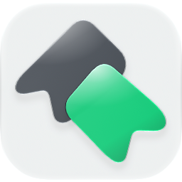
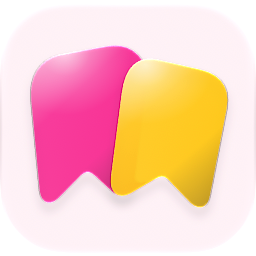

# SharedLinks app icons

| Main: B | Alternate: A |
| --- | --- |
|  |  |

Both designs use two overlapping bookmarks for links shared between friends,
with restrained glass effects and subtle rounded shading.

- **B — `SharedLinks.icon`:** the selected grey-and-green diagonal composition.
- **A — `SharedLinks-Colorful-A.icon`:** a colorful pink-and-yellow alternative
  with upright bookmarks leaning together.

Each `.icon` package is an editable, layered Icon Composer document. `source/A/`
and `source/B/` contain the flat SVG geometry. Each package's `Assets/` directory
contains the corresponding styled foreground layers with subtle volume gradients.

## Previews

`previews/A/` and `previews/B/` include native renders from Icon Composer 27.2's
`ictool`, using design generation 27, converted to sRGB using ColorSync `sips`.
Default previews are 1024×1024; dark, clear, and tinted previews are 512×512.
Each variant also has 64×64 and 256×256 default previews.
`render-manifest.json` records dimensions and SHA-256 hashes for the 12
appearance renders.

The PNGs include the system's rounded icon mask. They are review previews,
not ready-made PWA maskable assets. Tinted appearances use the renderer's
default tint, which is controlled by the user/system rather than the brand.

Open either `.icon` package with Icon Composer to edit it. For a future native
iOS target, add the chosen package to Xcode and select it as the app icon.
To render the main design from the repository root:

```sh
"/Applications/Xcode.app/Contents/Applications/Icon Composer.app/Contents/Executables/ictool" \
  assets/icon/SharedLinks.icon --export-image \
  --output-file /tmp/sharedlinks-default-native.png \
  --platform iOS --rendition Default \
  --width 1024 --height 1024 --scale 1 --design-generation 27
```

Other rendition names are `Dark`, `ClearLight`, `ClearDark`, `TintedLight`, and
`TintedDark`. Convert new exports to sRGB before replacing the checked-in
previews and refresh their manifest hashes.

## Integration status

This folder stores the design assets only. The current PWA icons, manifest,
service worker, and `tools/make_icons.py` are unchanged. A later integration
should update the generator together with the static icon outputs and check
the manifest's maskable safe area. App integration and installation on a
device have not been tested.
